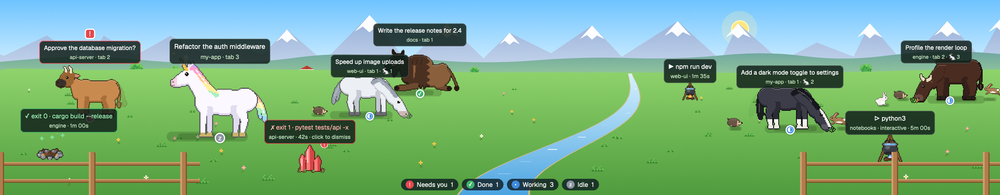

# NiuMa — a Herdr layout

Your coding agents graze in a pixel-art pasture: horses and cows of sixteen breeds that
graze, drink, wait with a red `!` or lie down when they're done; sub-agents are rabbits,
squirrels and hedgehogs; plain terminals are campfires, cooking pots and magic crystals
that burn while a command runs. Spaces and agents on the left, side-by-side panels in the
centre, a shell along the bottom.



See [RECIPE.md](RECIPE.md) for everything it shows and does, and how it's built.

## Install

1. Copy into your Herdr home (don't overwrite anything of yours; rename if a name is taken):

   | From this repo | To |
   |---|---|
   | `layouts/niu-ma.json`, `layouts/niu-ma.svg` | `~/.config/herdr-app/layouts/` |
   | `mods/niu-ma-pasture/` | `~/.config/herdr-app/mods/` |
   | `mods/niu-ma-bar/` | `~/.config/herdr-app/mods/` |

2. Merge `keys.json`'s `layout:niu-ma` section into your `~/.config/herdr-app/keys.json`
   (`⌘T` adds a side-by-side panel, `⌘⇧T` one with your first installed agent, `⌘W`
   closes just the focused panel; only in this layout).

3. Optional, for exit codes on terminal objects (zsh): add to `~/.zshrc`

   ```sh
   [[ -n $HC_TERMINAL_ID ]] && source ~/.config/herdr-app/mods/niu-ma-pasture/shell/niu-ma.zsh
   ```

4. Check and switch:

   ```sh
   for m in niu-ma-pasture niu-ma-bar; do herdr-app check ~/.config/herdr-app/mods/$m; done
   herdr-app do layout.switch '{"name":"niu-ma"}'
   ```

## Good to know

- It runs `hc` locally: `hc read` on agents' screens (questions and Claude Code
  sub-agents), `hc run` / `hc send` for the bottom shell, and `hc label` from the optional
  zsh hook. No network access, no files outside Herdr's folder.
- Put `"props": { "demo": true }` on the pasture block to see made-up agents and terminals
  in every state (that's how `preview.png` was taken).
- The sprites are generated: `python3 mods/niu-ma-pasture/tools/sprites.py`.
