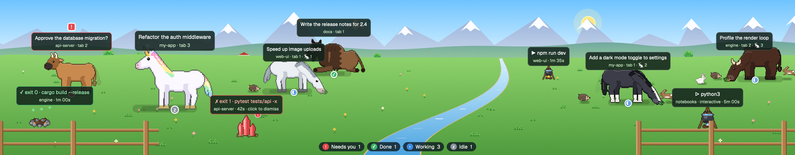

# Niuma (牛马)

A pasture across the top of the window where every coding agent is a pixel-art horse or
cow, grazing, waiting or lying down depending on its status. Sub-agents are rabbits,
squirrels and hedgehogs at their parent's feet, and every plain terminal (a dev server, a
test run, a REPL) is a cooking pot, fire pit or magic crystal that burns while a command
runs. Below the pasture: your spaces and agents on the left, the active tab's panels side
by side in the centre, and a long-lived shell along the bottom. Dark (`moss`) theme.



## What you see

Top to bottom, then left to right. The system title bar is hidden; on macOS the window
buttons sit over the sky at 14, 14. 1px dividers in the theme's `border` colour between
regions.

**Pasture**, 340px high (drag 180–600), the full width. Dragging empty sky or grass moves
the window. From back to front:

- **Sky**, the top 38% (the horizon is at 0.38 of the height), a vertical gradient
  `#6ec3ff` → `#dff4ff` by day, `#0b1230` → `#2c3f74` at night (19:00–06:00, checked
  once a minute) with 26 twinkling 1–2px stars. The sun (30px `#ffe680` disc with a
  `#fff6b8` 2px ring and a pulsing 52–62px `#fff3b040` glow) or a crescent moon sits at
  74% of the width.
- **Five clouds**, white pixel blobs (`#ffffff` with a `#dbe8f5` underside), 1.6–2.5×
  scaled, drifting back and forth across different stretches of the sky over 90–170 s;
  each cross-fades between two shapes every 7–13 s, so they slowly change. 35% opacity at
  night.
- **Far mountains**: a jagged range across the width, gradient `#93acd6` → `#cbdaee`
  (night `#34446e` → `#4a5d8a`), snow caps `#fbfdff` on the taller peaks.
- **Middle hills**, rounded, bluish green `#6fa6a0` → `#94c79a`; a little red barn (16×12
  art px) at 30% and four small trees at 13%, 17%, 47% and 86% along the hill foot.
- **Meadow**, rolling down to the bottom, `#8fd36c` → `#4f9b3d` (night `#2a5a33` →
  `#1c3f24`), with grass tufts and white, yellow and pink flowers scattered over it
  (46 per 1200px of width), a third of them swaying.
- **Creek**: winds from a thin line at the horizon (63% across) to a wide mouth at the
  bottom (about 52% across), widening with depth. Sandy banks `#cdbb84`, water gradient
  `#d6f2ff` → `#4aa3e0`, nine white shimmer streaks sliding across it.
- **Animals, critters and terminal objects**, drawn far to near, nearer ones larger
  (below).
- **Oak fence** right at the front, as if you're leaning on it: two runs only, the left
  20% and the right 20% of the width, the middle open. Posts 11px wide and 24% of the
  pasture high, every 150px; two rails 6px high. Oak `#b07d4b` with a `#cfa070` highlight
  and a `#7f5530` edge.
- **Name tags and command bubbles** (above everything else).
- **Status counts**, centred at the bottom between the fence runs: four pills, 20px high,
  `#0f1c22d0`, 11px white text, each with a 14px status circle: `! Needs you N`,
  `✓ Done N`, `• Working N`, `z Idle N`. A zero pill is dimmed.

Depth: an object's feet sit between `horizon + 7%` (far, t = 0) and `bottom − 16px` (near,
t = 1). An animal's art pixel is `(3 + 3t) × k` screen pixels, `k = height / 320` (0.55–1.8),
so a near cow is about 216px wide at the default height and a far one about 108px.

**Animals** (one per agent). 36 × 28 art units, drawn at 3 pixels per unit (108 × 84),
facing left or right. Sixteen breeds, each with its own size; each animal also varies
0.92–1.08 on top:

| Breed | Size | Look |
|---|---|---|
| Chestnut horse | 1.0 | red-brown `#b8693a`, dark mane |
| Grey horse | 1.0 | `#eceff3`, grey mane |
| Black horse | 1.05 | `#3d3d4a`, white blaze and socks |
| Palomino | 0.95 | gold `#e8bf6c`, cream mane |
| Pinto pony | 0.78 | white with brown patches |
| Bay horse | 1.0 | `#8a4b2a`, black mane and legs |
| Buckskin horse | 0.95 | tan `#dcb978`, black points |
| Appaloosa | 0.95 | white with dark spots on the rump |
| Shire draft horse | 1.25 | dark bay, white blaze and feathered socks |
| Holstein cow | 1.1 | white with black patches, pink muzzle |
| Jersey cow | 0.88 | `#c98a4f`, darker face, black nose |
| Highland cow | 0.92 | shaggy orange, fringe over the eyes, long horns |
| Hereford cow | 1.05 | red `#8e3b20`, white face and belly |
| Angus cow | 1.05 | black, no horns |
| Belted Galloway | 0.95 | black with a white belt, no horns |
| Brown Swiss cow | 1.12 | grey-brown `#8e7c6c`, dark muzzle |

Each is shaded (lighter top edge, darker bottom edge) with a one-pixel dark outline, an
eye with a white highlight, nostrils and a mouth line. No udders.

- **Name tag** over the head, always shown: a rounded 7px box `#10201ad9` with a 1px
  `#ffffff30` border (`#e5484d` when it needs you). Line 1: a short summary of the last
  question asked, 10.5–13px semibold white (up to 44 characters, first clause, leading
  "please / can you / could we…" dropped, then `…`). Line 2, 1.5px smaller, `#c9e8c4`:
  `<space> · tab <n>`, plus ` · 🐇 N` while N sub-agents are out.
- **Status badge** centred under its feet: a 15–26px circle with a 2px white border, in
  the status colour: working `#3d8be0` with a turning `◐◓◑◒`, needs you `#e5484d` with
  `!`, done `#3fb26b` with `✓`, idle `#8b93a1` with `z`.
- **Hover bubble**: a 280px cream `#fffdf6` speech bubble with a pointer, `📁 <space> ·
  <breed>`, `💬 <the whole question>`, and the status word, tab and program.

**Critters** (one per sub-agent), 16 × 12 art units at half the parent's scale: a brown
rabbit, a white bunny, a red squirrel holding a nut, or a hedgehog. They line up beside
the parent, alternately behind and in front of it, never on it.

**Terminal objects** (one per plain terminal), 12 × 12 art units at 0.75 of an animal's
scale (27–54px), scattered like the animals:

- **Fire pit**: a ring of grey stones around crossed logs on ash.
- **Cooking pot**: an iron pot of water hanging from a wooden tripod over two logs.
- **Magic crystal**: three crystal shards in a grass tuft; dim purple when idle.

**Below the pasture**, a row:

- **Sidebar**, 250px (44–480), `chrome` background: Herdr's `spaces` list over Herdr's
  `agents` list, half each (at least 90px each).
- **Centre column**:
  - **Bar**, 36px, `chrome`: 🐄 (🐎 when split), the space's name (12.5px semibold),
    its git branch (11px `dim` with a branch icon), `N panels`, the space's tabs as small
    pills (`Tab 1 ×2`) when there's more than one; on the right a `+ Split` button and one
    button per installed agent (up to three, the first filled with `accent`), 24px high,
    12px text, 6px radius.
  - **Panels**, `canvas` background with 6px padding: the active tab's panes as cards,
    6px apart, 8px radius, `background` fill, 1px `border` (1px `accent` when focused), a
    28px Herdr `pane` header on top of each; a single pane is framed too.
  - **Shell**, 210px (80–700): a 30px bar (terminal icon in `accent`, `Shell`, its
    folder in `dim`, and on the right `cd <focused panel's folder>`, `Clear`, `Restart`)
    over a live terminal.
- Terminals have 10 × 6px padding and full opacity.

## How it behaves

**Agent statuses**:

| Status | The animal | Tag |
|---|---|---|
| working | head down grazing, the head bobbing 1 art px every 0.65–0.95 s; tail swishing (two tail positions cross-fading every 1.3–1.9 s). A working animal whose spot is beside the creek (and with nobody else drinking there) steps to the bank and drinks with its nose at the water instead, a ripple ring growing at its muzzle | blue spinner badge |
| blocked (needs you) | standing, tail swishing; a bouncing 18–30px red `!` sign over its tag | red-bordered tag, `!` badge |
| done | lying down, legs folded, eyes closed in a happy arc, blushing | `✓` badge |
| idle | standing, tail swishing | `z` badge |

- **Spots.** A new animal fades in (0.9 s) at the open spot farthest from everyone, out of
  48 tries that keep its whole body off the creek. It keeps that spot (remembered across
  restarts); animals never slide around. They're drawn far to near.
- **Questions.** The tag's summary and the bubble's question are the last prompt line on
  the agent's screen (`❯`, `›` or `>` followed by text), read with `hc read <t> --lines
  400`. The input box at the bottom (a prompt line right under a `────` rule) is skipped:
  it's a draft. Read again on every new turn, on hover (at most every 20 s) and every
  2.5 s while working. Falls back to the terminal title if that says more than the
  program's name, else `No question yet`.
- **Sub-agents.** Two kinds, both shown as critters:
  - Herdr's own: terminals whose `parent` is an agent (`hc run` from an agent), while
    live and not done. Clicking one peeks at it.
  - Claude Code's Task/Agent calls, read off the parent's screen in the current turn:
    `⏺ Agent(<what>) <model>` (or `Task(…)`, or any tool call whose output counts tool
    uses), `⏺ N background agents launched` followed by `├ <what>` / `└ <what>` lines,
    and any later `⏺ Agent "<what>" …` status line (a fan-out's launch list names only
    the first two; e.g. `… is waiting on its own background work` names the rest).
    Finished when `Done (` shows under the call, or `⏺ Agent "<what>" finished`
    (completed, failed, stopped) appears. A name that shows up again after it finished is
    a new sub-agent (the same task fanned out twice in one turn). Clicking one goes to the
    parent.
  - Busy critters sit and nibble (bobbing 0.5 art px), one in three hops back and forth;
    one that needs input wears a small `!`. Each stays at least 6 s, so a quick one is
    still seen. Finished (or when the parent stops working), it hops off the nearer edge
    of the meadow over 2.6 s and is gone. Hovering one shows `Sub-agent · Working:
    <what>`.
- **Terminal objects** (any of Herdr's terminals that isn't an agent or an agent's
  sub-agent, plus the bottom shell):

  | State | Fire pit | Pot | Crystal | Bubble |
  |---|---|---|---|---|
  | idle | unlit logs | still, no fire | dim purple | none (hover: `last: <cmd>` and its exit) |
  | running | flickering flames (two shapes cross-fading every 0.26–0.42 s), an orange glow, three sparks and two smoke puffs rising | fire under the pot, three bubbles popping on the water, two steam puffs (four after 30 s) | bright violet, pulsing every 1.2–1.5 s, four particles floating up | after 2 s: `▶ <command>` (40 characters, `…`), `<project> · <elapsed>` ticking every second; hover shows the whole command |
  | interactive (a REPL, editor, pager, `ssh`, …) | a small steady blue flame | a small blue fire | steady blue | `▷ <command>`, `<project> · interactive · <elapsed>` |
  | success | out, five green `✦` rising | still, green `✦` | green, `✦` | green border: `✓ exit 0 · <command>`, `<project> · <duration>`, for 4 s, then idle |
  | failed | out, six red sparks bursting outward for 2.5 s, a red `!` badge | same | red, sparks, `!` | red border: `✗ exit <code> · <command>`, `<project> · <duration> · click to dismiss`; stays until clicked or another command starts |

  `<project>` is the terminal's space name (`Shell · <folder>` for the bottom shell).
  Interactive means the foreground program is one of vim, nvim, vi, nano, emacs, less,
  more, man, top, htop, btop, ssh, mosh, psql, mysql, sqlite3, redis-cli, mongosh,
  lazygit, tig, tmux, fzf, k9s, bash, zsh, fish, sh, or an interpreter (python, node,
  ipython, irb, ghci, lua, R, deno, bun, julia) started with no script. Clicking an object
  focuses its terminal (and dismisses a failure).
- **Clicks.** An animal or its tag: focus its pane (`pane.focus`, or `terminal.peek` for
  one without a pane). Pressing on any of them doesn't drag the window.
- **Bar.** `+ Split` and `⌘T` add a panel to the current tab instead of a new tab: they
  split the widest panel (by its terminal's columns) to the right, so panels stay side by
  side across the centre. The agent buttons and `⌘⇧T` (the first installed agent) do the
  same with that agent running. Tab pills select their tab. `⌘W` closes only the focused
  panel (Herdr closes the tab with its last panel, and asks before closing a space).
- **Shell.** The bottom terminal is a kept core terminal named `niu-ma-shell` with no
  space labels (so it's in no space). `cd …` types `cd '<folder>'` into it and focuses it,
  `Clear` types `clear`, `Restart` ends it. Whenever it's gone (exited, restarted, a fresh
  install), the shell bar starts a new one within 4 s and puts the terminal block back.

## Built from

**Layout** `layouts/niu-ma.json`:

```
root (column, theme moss, titlebar none, traffic_lights [14,14], terminal_padding [10,6],
      terminal_opacity 1, divider 1 border, preview layouts/niu-ma.svg)
├─ pasture   block 340px (180–600), window_drag   mod niu-ma-pasture
└─ body      row, divider 1 border
   ├─ sidebar  column 250px (44–480), background chrome, divider 1 border
   │  ├─ spaces  block weight 1, min 90   mod spaces   (Herdr's)
   │  └─ agents  block weight 1, min 90   mod agents   (Herdr's)
   └─ work     column, divider 1 border
      ├─ bar     block 36px                mod niu-ma-bar
      ├─ main    block, background canvas, padding 6
      │          tab active, pane { header { mod pane, height 28, top, reveal always },
      │          background background, border 1 border, focus 1 accent, radius 8, gap 6,
      │          lone true }
      └─ shell   column 210px (80–700)
         ├─ shell-bar   block 30px   mod niu-ma-bar  props { role: "shell" }
         └─ shell-term  block  { terminal: <address> }   (added by niu-ma-bar at run time)
```

`keys.json`, merged into the person's:

```json
{ "layout:niu-ma": { "cmd-t": "niu-ma-bar.split", "cmd-shift-t": "niu-ma-bar.split-agent", "cmd-w": "pane.close" } }
```

**`mods/niu-ma-pasture/`** (`mod.json`: `{ "place": "none" }`; props: none, or
`{ demo: true }` for made-up agents and terminals in every state, used for the preview):

- `main.js`: the scene (sky, mountains, hills, meadow and creek as native `paint_path`
  polygons with linear gradients), placement, animals, tags, critters, terminal objects,
  bubbles, fence and counts. All motion is native (`loop`, `frames`, `transition`); the
  only timers are a 1 s tick while a bubble's clock or a flash is showing, 2.5 s screen
  reads for working agents and a 60 s day/night check.
- `sprites/`: 237 SVGs, generated by `tools/sprites.py` (Python 3, no packages):
  `<breed>-stand|graze-body|graze-head|sit-<r|l>`, `<breed>-tail-<a|b>-<r|l>` (16 breeds),
  `critter-<rabbit|bunny|squirrel|hedgehog>-<sit|hop>-<r|l>`, `obj-firepit-base`,
  `obj-firepit-flame-<a|b|blue>`, `obj-pot-base`, `obj-pot-fire-<a|b|blue>`,
  `obj-crystal-<dim|lit|blue|green|red>`, clouds, tufts, flowers, a tree, a barn.
  `tools/hd.py` draws animals from ellipses, polygons and tapering strokes rasterised at
  3 px per art unit, then shades and outlines them; `critters.py` and `objects.py` use the
  same shapes.
- `shell/niu-ma.zsh`: zsh shell integration. In a Herdr terminal (`$HC_TERMINAL_ID` set)
  its `preexec` / `precmd` hooks run `hc label "$HC_TERMINAL_ID" …` in the background,
  recording `niu-ma.state` (running/done), `niu-ma.cmd`, `niu-ma.start`, `niu-ma.exit`
  and `niu-ma.end` (ms) on the terminal. The pasture reads them from `terminals()`.
- `herdr` functions: `agents`, `terminals`, `spaces`, `panes`, `run`, `hc`, `settings`,
  `props`. Commands: `pane.focus`, `terminal.peek`.
- Shared/stored: `localStorage` `spots` (each animal's and object's spot).

**`mods/niu-ma-bar/`** (`mod.json`: `{ "place": "none" }`; props `{}` for the bar over the
panels, `{ role: "shell" }` for the shell's bar):

- `herdr` functions: `spaces`, `panes`, `focused`, `terminals`, `run`, `theme`, `props`,
  `layout`, `knownAgents`, `nextCommand`, `hc`, `home`.
- Commands: `pane.split` (right, with `argv` for an agent), `tab.select`, `tab.new` (an
  empty tab), `pane.focus`, `terminal.kill`, `layout.set` (to put the shell block back).
- Key commands (`nextCommand`): `split`, `split-agent`.
- Icons from Herdr's `workspace-chrome`: `git-branch.svg`, `plus.svg`, `terminal.svg`.

**Herdr's mods it uses**: `spaces`, `agents`, `pane`.

## Watch out

- **Programs it runs.** `niu-ma-pasture` runs `hc read <terminal> --lines 400` on agents'
  terminals (to read the question and sub-agents); it reads screen text, never sends.
  `niu-ma-bar` runs `hc run --json --keep --bg --no-parent --name niu-ma-shell --label
  niu-ma.role=shell --cwd ~` to start the shell, and `hc send --force <shell> …` for
  `cd` and `Clear`. The zsh hook runs `hc label` around every command. Nothing calls
  `fetch` or reaches the network, and no files outside Herdr's folder are read or written.
- **The zsh hook needs one line in `~/.zshrc`:**
  `[[ -n $HC_TERMINAL_ID ]] && source ~/.config/herdr-app/mods/niu-ma-pasture/shell/niu-ma.zsh`.
  Without it, objects still show running (from the core's foreground process: its pid
  differs from the shell's), the command line and elapsed time, but a finished command
  shows `✓ finished` with no exit code and failures look like successes. Other shells
  (bash, fish) have no hook yet.
- **Sub-agents and questions come from screen text**, so they follow Claude Code's
  output format (`⏺ Agent(…)`, `background agents launched`, `Agent "…" <status>`,
  `Done (`). Don't trust the launch list alone: with four or more it names only the
  first two. Another agent's sub-agents only show if they're Herdr terminals.
- **Zoom.** `on_size_change` reports zoomed pixels while the mod's own pixels are zoomed
  too: divide the size by `settings().zoom`, or the scene overflows at any zoom but 1.
- **Herdr removes a terminal block when its terminal ends**, so the shell bar has to add
  `shell-term` back (via `layout.set`), not just repoint it. Don't ship a layout with a
  terminal address in it: it means another terminal (or nothing) on another machine.
- **Write `mod.json` before `main.js`** when creating the mods: a folder Herdr sees without
  `mod.json` gets docked into whatever layout is showing.
- **Positions.** Placement is by fractions of the panel, but the creek, scale and fence
  depend on its height: test at 180px and 600px. Very wide windows spread animals thin.
- **Glyphs.** Some symbols (e.g. `⌨`) aren't in the UI font and draw as boxes; `▶ ▷ ✓ ✗ ✦
  ! ◐◓◑◒ 🐇` are fine.
- **Assumes** Herdr's `spaces`, `agents` and `pane` mods and `workspace-chrome` icons
  (a default install), `hc` on the shell's PATH, macOS key names (`cmd-…`) in `keys.json`.

## Done when

- `herdr-app check` passes for `mods/niu-ma-pasture` and `mods/niu-ma-bar`.
- `herdr-app do layout.switch '{"name":"niu-ma"}'` shows the pasture on top, spaces and
  agents on the left, the bar, framed panels with headers, and within a few seconds a
  live shell at the bottom.
- Every agent is a horse or cow with a name tag (question summary, `space · tab`) and a
  status badge under its feet; the bottom-centre pills count them.
- A working agent grazes (or drinks at the creek), a blocked one gets the red `!` sign,
  a done one lies down, an idle one stands swishing its tail.
- Asking a Claude Code agent to "fan out 4 subagents that each run for 20 seconds" puts
  four critters beside it (`🐇 4` on its tag); they hop away after they finish. Asking
  again in the same turn shows four again.
- In the bottom shell with the hook loaded, `sleep 6` shows a running bubble after 2 s
  with a ticking time; `ls /nonexistent` leaves a red `✗ exit 1` until clicked; `true`
  flashes green `✓ exit 0`; `python3` shows a steady blue flame.
- `⌘T` adds a side-by-side panel to the current tab; `⌘W` closes just that panel.
- With `"props": { "demo": true }` on the pasture block, the scene matches `preview.png`.
